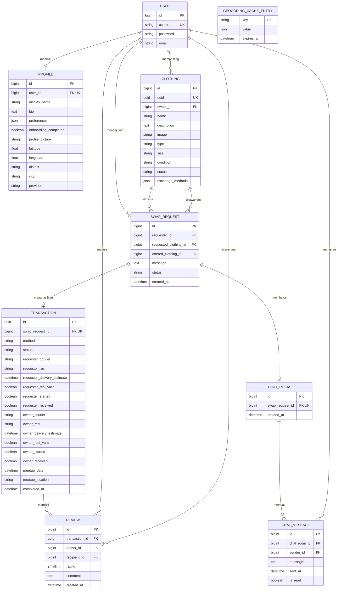

<div align="center">

# Swapify

#### Swap Smartly, Wear Happily

<p>
  
  
  
  
  
</p>

**F12 - PBP F**

</div>

---

## Description

**Swapify** adalah platform pertukaran pakaian bekas layak pakai yang mempertemukan pengguna untuk menemukan pakaian, mengajukan pertukaran, dan menyelesaikan transaksi melalui pertemuan langsung atau pengiriman.

Dengan konsep *slow fashion* dan *reuse*, Swapify membantu memperpanjang siklus penggunaan pakaian serta mendorong gaya hidup berkelanjutan.

## Group Members

<table width="100%">
  <thead>
    <tr>
      <th width="120">Profile</th>
      <th width="420">Nama</th>
      <th width="180">NPM</th>
      <th width="420">Tanggung Jawab</th>
    </tr>
  </thead>
  <tbody>
    <tr>
      <td align="center">
        <a href="https://github.com/leficullen">
          
        </a>
      </td>
      <td><strong>Muh. Alfi Rizqy</strong></td>
      <td>2506550721</td>
      <td>Profile &amp; Location<br/>Review &amp; Rating</td>
    </tr>
    <tr>
      <td align="center">
        <a href="https://github.com/rahelaruan91">
          
        </a>
      </td>
      <td><strong>Rahel Meilinda Aruan</strong></td>
      <td>2506598513</td>
      <td>Chat</td>
    </tr>
    <tr>
      <td align="center">
        <a href="https://github.com/popolkuproi">
          
        </a>
      </td>
      <td><strong>Naufal Alvaro Habibullah</strong></td>
      <td>2506657144</td>
      <td>Clothing Catalog</td>
    </tr>
    <tr>
      <td align="center">
        <a href="https://github.com/muhammaddawood-ui">
          
        </a>
      </td>
      <td><strong>Muhammad Dawood Alfathiin</strong></td>
      <td>2506610456</td>
      <td>Swap Request</td>
    </tr>
    <tr>
      <td align="center">
        <a href="https://github.com/mwf-yesido">
          
        </a>
      </td>
      <td><strong>Muh. Wildan Firdaus</strong></td>
      <td>2506595985</td>
      <td>Transaction</td>
    </tr>
  </tbody>
</table>

## Main Features

- **Account & Profile**: Registrasi, login, onboarding, foto profil, bio, preferensi gaya, dan lokasi pengguna.
- **Clothing Discovery**: Penelusuran katalog dengan pencarian, filter, pagination, serta rekomendasi berdasarkan preferensi dan perkiraan jarak ketika lokasi tersedia.
- **Personal Wardrobe**: Pengelolaan listing pakaian beserta foto, kategori, ukuran, kondisi, dan metode pertukaran.
- **Swap Requests**: Pengajuan, penerimaan, penolakan, dan pembatalan permintaan pertukaran dengan validasi kepemilikan serta ketersediaan pakaian.
- **Exchange Management**: Pengaturan meetup atau pengiriman, informasi kurir dan resi, kesiapan kedua pihak, serta konfirmasi penerimaan.
- **Chat**: Komunikasi setelah swap disetujui melalui AJAX dan polling, dengan riwayat pesan, status dibaca, serta indikator pesan belum dibaca.
- **Review & Rating**: Ulasan dan penilaian 1–5 setelah transaksi selesai, yang ditampilkan pada profil penerima.

## User Flow

1. Pengguna mendaftar dan melengkapi profil, preferensi gaya, serta lokasi.
2. Pengguna menambahkan pakaian yang ingin ditukarkan ke wardrobe.
3. Pengguna menemukan pakaian di katalog dan mengajukan swap dengan menawarkan pakaian miliknya.
4. Pemilik pakaian menerima atau menolak permintaan; pengaju dapat membatalkan permintaan yang masih pending.
5. Saat permintaan diterima, kedua pakaian menjadi `reserved`, ruang chat dibuka, dan transaksi dibuat.
6. Kedua pihak menyepakati detail meetup atau pengiriman, lalu menyatakan kesiapan untuk memulai transaksi.
7. Setelah kedua pihak mengonfirmasi penerimaan, transaksi menjadi `Completed` dan pakaian menjadi `swapped`.
8. Masing-masing pihak dapat memberikan satu review untuk transaksi tersebut.

## Modules Details

### 1. Profile & Location

**PIC:** Muh. Alfi Rizqy  
**App:** `apps/user_profile` · **URL utama:** `/profile/`

Mengelola identitas pengguna serta informasi yang digunakan oleh modul katalog dan profil publik.

- Registrasi, login, logout, dan onboarding.
- Pengaturan nama tampilan, bio, foto profil, serta preferensi gaya.
- Penyimpanan koordinat dan informasi kecamatan, kota, serta provinsi.
- Reverse geocoding melalui Nominatim untuk menerjemahkan koordinat menjadi informasi area.
- Profil pribadi, profil publik, dan tampilan review pengguna.
- Cache geocoding bersama untuk mengurangi permintaan berulang ke layanan eksternal.

**Model:** `Profile`, `GeocodingCacheEntry`.

### 2. Clothing Catalog

**PIC:** Naufal Alvaro Habibullah  
**App:** `apps/clothing_catalog` · **URL utama:** `/clothing-catalog/`

Mengelola pakaian yang tersedia untuk ditukarkan dan membantu pengguna menemukan listing yang sesuai.

- Membuat, melihat, mengubah, dan menghapus listing.
- Informasi foto, nama, deskripsi, jenis, ukuran, kondisi, dan metode pertukaran.
- Pencarian, filter, pagination, serta wardrobe pribadi.
- Discovery berdasarkan preferensi dan perkiraan jarak ketika lokasi tersedia.
- Pembaruan hasil katalog secara dinamis.
- Perubahan dan penghapusan listing dibatasi kepada pemilik untuk pakaian berstatus `available`.

**Model:** `Clothing`.

### 3. Swap Request

**PIC:** Muhammad Dawood Alfathiin  
**App:** `apps/swap_request` · **URL utama:** `/swap-request/`

Menghubungkan pakaian yang diminta dengan pakaian yang ditawarkan.

- Membuat permintaan dengan pesan opsional.
- Melihat, mencari, dan mengelola permintaan masuk maupun keluar.
- Menerima, menolak, atau membatalkan permintaan sesuai peran pengguna.
- Memastikan pakaian yang ditawarkan dimiliki pengaju dan pakaian yang diminta dimiliki pengguna lain.
- Memvalidasi ketersediaan kedua pakaian dan kesamaan metode pertukaran.
- Mencegah permintaan pending berulang dari pengaju yang sama untuk pakaian yang sama.
- Penerimaan swap sekaligus mereservasi kedua pakaian, membuka chat, dan membuat transaksi.

**Model:** `SwapRequest`.

### 4. Transaction

**PIC:** Muh. Wildan Firdaus  
**App:** `apps/transaction` · **URL utama:** `/transaction/<uuid>/`

Mengelola pelaksanaan pertukaran setelah swap request diterima.

- Pilihan metode `Meetup` atau `Delivery` sesuai metode yang didukung kedua pakaian.
- Pengaturan waktu dan lokasi meetup.
- Pencatatan kurir, nomor resi, dan estimasi pengiriman masing-masing pihak.
- Konfirmasi resi dan kesiapan sebelum transaksi dimulai.
- Konfirmasi penerimaan barang oleh masing-masing pihak.
- Penyelesaian transaksi setelah kedua pihak menerima barang.

**Model:** `Transaction`.

### 5. Chat

**PIC:** Rahel Meilinda Aruan  
**App:** `apps/chat` · **URL utama:** `/chat/`

Menyediakan komunikasi antara kedua peserta pertukaran.

- Satu ruang chat untuk setiap swap request.
- Chat aktif ketika swap request berstatus `accepted`.
- Pengiriman pesan melalui AJAX dan pengambilan pesan melalui polling.
- Pemuatan riwayat pesan bertahap dan pengaturan scroll.
- Status dibaca, badge pesan belum dibaca, serta indikator pengiriman.
- Penanganan kegagalan pengiriman dan pencegahan pesan duplikat.

**Model:** `ChatRoom`, `ChatMessage`.

### 6. Review & Rating

**PIC:** Muh. Alfi Rizqy  
**App:** `apps/review_rating` · **URL utama:** `/reviews/transaction/<uuid>/`

Mencatat pengalaman pertukaran dan membangun reputasi pengguna.

- Review hanya dapat diberikan oleh peserta setelah transaksi selesai.
- Rating berupa angka 1–5 dengan komentar opsional maksimal 1.000 karakter.
- Satu review per penulis untuk setiap transaksi.
- Pengguna tidak dapat memberikan review kepada dirinya sendiri.
- Review ditampilkan pada profil penerima.

**Model:** `Review`.

## Database Relations

Diagram berikut menampilkan relasi dan atribut utama berdasarkan model Django dalam repository.



`PK` = primary key, `FK` = foreign key, dan `UK` = unique key.

`GeocodingCacheEntry` merupakan tabel cache pendukung tanpa foreign key ke model lain. Peserta transaksi dan chat diperoleh melalui `SwapRequest`.

## External Services

### Nominatim

Digunakan untuk **reverse geocoding**, yaitu mengubah koordinat pengguna menjadi informasi kecamatan, kota, dan provinsi.

Konfigurasi tersedia melalui `NOMINATIM_BASE_URL` dan `NOMINATIM_USER_AGENT`.

### Cloudinary

Digunakan untuk menyimpan dan menyajikan foto profil serta gambar pakaian.

Konfigurasi tersedia melalui `CLOUDINARY_CLOUD_NAME`, `CLOUDINARY_API_KEY`, dan `CLOUDINARY_API_SECRET`.

## Project Structure

```text
swapify/
├── apps/
│   ├── main/                 # Halaman utama
│   ├── user_profile/         # Akun, profil, onboarding, lokasi
│   ├── clothing_catalog/     # Katalog dan wardrobe
│   ├── swap_request/         # Permintaan pertukaran
│   ├── transaction/          # Pelaksanaan pertukaran
│   ├── chat/                 # Ruang chat dan pesan
│   ├── review_rating/        # Review dan rating
│   └── design_system/        # Referensi komponen antarmuka
├── common/                   # Utilitas bersama
├── config/                   # Settings dan routing utama
├── theme/                    # Tema, Tailwind, dan aset
├── static/                   # Static assets
├── manage.py
├── requirements.txt
├── requirements-dev.txt
└── .env.example
```

## Local Development

### 1. Siapkan environment

Jalankan dari direktori repository:

```bash
python -m venv env
source env/bin/activate
pip install -r requirements.txt
cp .env.example .env
```

Untuk Windows, aktivasi environment menggunakan:

```powershell
env\Scripts\activate
```

### 2. Isi konfigurasi

Lengkapi `.env` dengan `SECRET_KEY` dan kredensial Cloudinary untuk fitur unggah gambar.

```dotenv
PRODUCTION=False
DEBUG=True
SECRET_KEY=isi-dengan-secret-key-lokal
CLOUDINARY_CLOUD_NAME=
CLOUDINARY_API_KEY=
CLOUDINARY_API_SECRET=
NOMINATIM_BASE_URL=https://nominatim.openstreetmap.org
NOMINATIM_USER_AGENT=Swapify/1.0 (+https://github.com/F12-PBP/swapify)
```

Ketika `PRODUCTION=False`, aplikasi menggunakan SQLite. Mode produksi menggunakan PostgreSQL melalui konfigurasi `DB_NAME`, `DB_USER`, `DB_PASSWORD`, `DB_HOST`, `DB_PORT`, dan `SCHEMA` opsional.

Jangan commit `.env` atau kredensial layanan.

### 3. Jalankan aplikasi

```bash
python manage.py migrate
python manage.py tailwind install
python manage.py tailwind build
python manage.py runserver
```

Untuk pengembangan dengan pembaruan Tailwind otomatis:

```bash
honcho start -f Procfile.tailwind
```

Buka aplikasi di [localhost:8000](http://127.0.0.1:8000/) dan referensi design system di [/ds/](http://127.0.0.1:8000/ds/).

### 4. Jalankan pengujian

```bash
python manage.py test
```

### Marketplace Demo Data

Petunjuk pengisian data demo berisi 20 pengguna fiktif dan 52 produk tersedia pada [Marketplace Seeder Guide](apps/clothing_catalog/seed_data/README.md), termasuk dry run, pengaturan password demo, dan pengulangan seed.

## AI Disclosure

Pengungkapan berikut merangkum penggunaan AI berdasarkan keterangan masing-masing anggota. Kontribusi AI berbeda pada setiap modul; keputusan akhir, pemahaman kode, dan verifikasi hasil tetap menjadi tanggung jawab pengembang terkait.

### Muh. Alfi Rizqy: Profile & Location; Review & Rating

- **Kontribusi mandiri:** Sebagian besar logika utama, arsitektur, backend, dan frontend dasar dikerjakan sendiri, termasuk penentuan lingkup serta baseline pengujian.
- **Bantuan AI:** Debugging, saran optimasi, pekerjaan berulang, integrasi tool eksternal, penulisan unit test, serta penyempurnaan animasi dan interaksi antarmuka.
- **Tanggung jawab:** Menentukan pendekatan implementasi dan skenario pengujian, lalu meninjau serta memverifikasi hasil bantuan AI.

### Rahel Meilinda Aruan: Chat

- **Penggunaan AI:** Menggunakan OpenAI Codex sejak awal pengembangan untuk memahami Class-Based Views dan merancang integrasi model, relasi, URL, serta view sesuai ERD tim.
- **Bantuan AI:** Menghasilkan dan menyempurnakan sebagian kode backend serta frontend chat, termasuk AJAX, polling, status pesan, riwayat, penanganan kegagalan, dan penyesuaian Tailwind berdasarkan Figma serta design system tim.
- **Tanggung jawab:** Memahami dan meninjau kode yang digunakan, menguji kesesuaiannya dengan kebutuhan modul, serta memperbaiki masalah yang ditemukan.

### Naufal Alvaro Habibullah: Clothing Catalog

- **Penggunaan AI:** Menggunakan Codex dan Copilot di VS Code sebagai pendamping untuk mencari solusi, menyusun dan memperbaiki kode, serta meninjau kasus tepi.
- **Bantuan AI:** CRUD katalog, pencarian, filter, pagination, discovery berdasarkan preferensi dan perkiraan lokasi, interaksi antarmuka, serta peninjauan akses dan status listing.
- **Tanggung jawab:** Menentukan desain akhir dan memeriksa perilaku katalog, kepemilikan, status pakaian, serta privasi lokasi sebelum menerapkan saran AI.

### Muhammad Dawood Alfathiin: Swap Request

- **Penggunaan AI:** Menggunakan Claude untuk memperdalam pemahaman Class-Based Views sebagai pembanding dan pengayaan materi kelas.
- **Bantuan AI:** Perancangan struktur backend sesuai ERD tim, usulan kode dan logika yang diadaptasi untuk kebutuhan modul, serta penyesuaian frontend dengan Tailwind CSS berdasarkan desain Figma.
- **Tanggung jawab:** Menentukan penerapan kode, memahami implementasi, melakukan pengujian dan debugging, serta memastikan kualitas dan fungsionalitas modul.

### Muh. Wildan Firdaus: Transaction

- **Penggunaan AI:** Menggunakan ChatGPT dan Gemini untuk membantu memahami Class-Based Views, Tailwind CSS, serta masalah selama pengembangan.
- **Bantuan AI:** Penelusuran penyebab bug, penyempurnaan alur program, dan eksplorasi kombinasi CSS untuk antarmuka transaksi.
- **Tanggung jawab:** Memeriksa seluruh kode yang digunakan dan memperbaiki kekurangan atau kesalahan pada saran AI.

## Deployment & Design

| Resource | Tautan |
| :--- | :--- |
| Deployment | https://muh-alfi-swapify.pws.cs.ui.ac.id/ |
| Figma | https://www.figma.com/design/zbqXXY2vi6KXI1w4Agn4DO/Swapify?node-id=250-510&t=j8oUGtqQzmIFYrRN-1 |

---

<div align="center">

### Swapify

**Swap Smartly, Wear Happily**

**F12 — PBP F**

Alfi · Rahel · Alvaro · Dawood · Wildan

</div>
